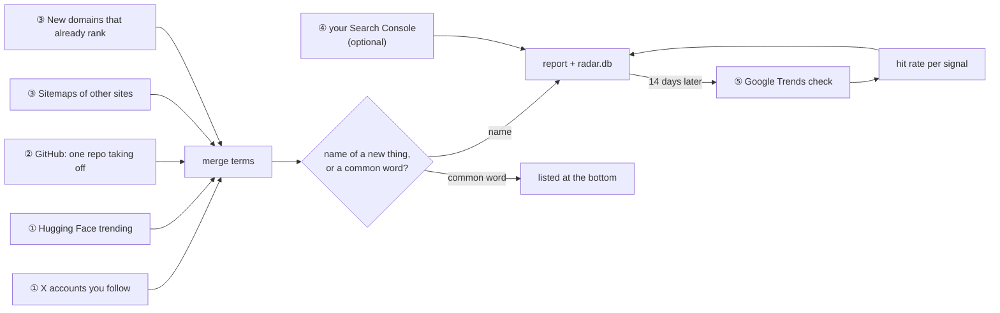

# new-term-radar

[中文说明](README.zh-CN.md)

A daily report of the names that are starting to surge in AI: new models, products, tools and repos, caught where they are said first, before they show up in keyword tools.

Built for people who make pages, posts or products around new terms: SEO for AI tool sites, newsletters, directories, anyone who wants to know about "Strata" or "Seedance" the day it appears and not two weeks later.

## Why

A new name leaves a trail, in this order:

1. A lab or a well-followed account says it on X; a model enters Hugging Face's trending list.
2. One GitHub repo takes off on its own.
3. Directories and competitors add pages for it; someone registers a domain for it and the site starts to rank.
4. Your own site gets its first search impressions for it.
5. Google Trends shows the curve, days or weeks later.

Keyword tools read step 5. This radar reads steps 1 to 4 every day and uses step 5 only to check itself.

One example it was built around: [Niko1221/Strata](https://github.com/Niko1221/Strata) was created on 2026-09-24 and had 7,700 stars nine days later. People were searching "niko strata" from 9/26, while no second repo carried the name and no keyword tool listed it. A single repo gaining 800 stars a day is the whole signal, and it is public.

## What it reads



| Signal | What it catches | Needs | Cost |
|---|---|---|---|
| ① X | Names the accounts in your list used for the first time in 60 days | AIsa key | $0.003 per account per run |
| ① Hugging Face | Models new to the trending top 50; quantised copies grouped under the base name | nothing | free |
| ② GitHub breakout | A repo under 14 days old averaging 200+ stars a day, or +400 since yesterday; adds the search variants people use ("niko strata") | nothing (a GitHub token raises the rate limit) | free |
| ③ Sitemaps | Words that several new URLs on a site share and its older URLs rarely carried | the sitemaps you list | free |
| ③ New sites | Domains registered and first indexed in the last 90 days that already rank for 20+ keywords | AIsa key | about $0.13 per query, weekly |
| ④ Search Console | Queries your site got impressions for, for the first time (fresh data) | your own Google token | free |
| ⑤ Review | Each lead checked in Google Trends 14 days later, against its own baseline; hit rate and days ahead per signal | AIsa key | $0.0012 per search variant |
| Keyword table | For the day's new names: the generic search terms behind them (what people do with the new thing), each sized and given a decision | AIsa key | about $0.15 a day for 5 names |
| Name judge | A small model scores every term: the name of one specific thing, or a common word? | AIsa key | a fraction of a cent per run |

Prices are what AIsa charged in October 2026. With the example config (35 X accounts read three times a day, the keyword table for 5 names a day) a month costs about $15: $10 for the X reads, $5 for the keyword table. Read fewer accounts, or read them once a day, and it drops in proportion.

## The keyword table

A name is half of what you need. "SynthID Detector" has a short life as a keyword and belongs to Google; the job it does, "ai image detector", is what people keep searching, and nobody owns it. Each day the radar reads the new names once more and writes one table with both:

```
| Keyword | Type | Behind | New? | Est. searches/day | Started rising | Peak vs gpts | Peak day | Last 7 days vs the 7 before | Now | Decision |
| **photocraft** | name | — | yes | 12747 | 2026-10-05 | 97 vs 3.1 | 2026-10-09 | — | still rising | **prioritize** |
| **claude haiku 5.5** | name | — | yes | 1863 | 2026-10-07 | 100 vs 23.7 | 2026-10-08 | ×6.0 | still rising | **prioritize** |
| **ai image detector** | generic | synthid detector | no | 2537 | — | 87 vs 31.6 | 2026-10-04 | ×1.2 | flat | watch |
| **photoshop alternative** ⚠ | generic | photocraft | no | 244 | — | 61 vs 61.7 | 2026-10-08 | ×1.8 | flat | skip |
```

(a real run, 2026-10-12, shortened)

How it is made (`radar/usecases.py`):

1. **Evidence**: the most-liked posts that mention the name (X advanced search) and, for a repository, its README.
2. **Phrases**: a model reads the evidence and writes the keyword an ordinary person would type for each job it sees people doing, with a quote that backs it. A phrase built on another product's name ("photoshop alternative") is kept and marked ⚠: demand often hangs on the incumbent, and whether to use someone's brand is your call.
3. **Screen**: a second call scores how well the name answers each phrase; the loosely related ones are dropped. For Claude Haiku 5.5 it dropped all six proposed ("ai coding assistant", "github copilot alternative"); for SynthID Detector it kept all five.
4. **Volume**: Google Ads monthly searches for the rest, one batch call. Phrases under `min_volume` are dropped; most are.
5. **Trends**, twice per row: the term alone gives the shape (new or not, the day it started rising, the peak, the last week against the week before, what it is doing now); the term beside a benchmark keyword (`gpts` by default) gives the size.

Searches a day are estimates. A generic term's come from its own Google Ads volume, moved to today along its own Trends curve. The benchmark is then sized from those terms, and a name, which has no volume data yet, is sized against the benchmark.

Decision: **prioritize** = rose in the last 30 days, still up, at least `min_daily` searches a day. **watch** = rose but smaller, too early to read, or flat with steady demand of that size. **skip** = fading, or flat and small.

Each name is read twice, the day it appears and three days later, because on announcement day the posts are announcements and no use shows yet. The generic terms are kept as leads and reviewed after 14 days like the names.

What to expect from it, from the first eight names we ran it on:

- **The names rose; the generic terms did not, within five days.** PhotoCraft, Claude Haiku 5.5 and SynthID Detector all climbed clearly. None of the generic terms behind them moved in that time. A release sends people searching for its name first; whether the generic term follows later is what the 14-day review will show, and we have no result yet.
- So the table's use today is to tell you **which existing demand a new thing serves and how big it is** ("ai image detector", about 2,500 searches a day), not to catch a generic term taking off.
- For pure model releases (Claude Haiku 5.5, Nano Banana 2.1) the evidence was announcements and benchmarks, and the phrases proposed were weak ("ai coding assistant"). It works better for products and repositories that do one job.
- **Google Trends' last two days are not settled.** For unrelated terms they came back as 0 and then 100, which reads as a spike. Our first pass was fooled by exactly this; every reader in the code now drops those two days, and a rise must last two days to count.
- Google Ads volumes run about two months behind. Trends reads nothing reliable for terms under a few hundred searches a month.

Set `"usecases": {"per_day": 0}` or pass `--skip usecases` to turn it off.

## One key

By default, everything paid goes through [AIsa](https://go.aisa.one/yansen-zhu): X posts, Google Trends and domain data (DataForSEO behind it) and the model that judges names. One key, pay per call, no subscriptions to X's API or DataForSEO.

> That link is a referral link: signing up through it supports this project. The radar works the same with a key from anywhere on aisa.one.

Without a key the free signals still run (Hugging Face, GitHub, sitemaps, Search Console); the report then lists every term unsorted, because nothing judges which are names.

### Optional Glasser data backend

Google Trends and Google Ads search volume can independently use [Glasser](https://glasser.ai/):

```json
"data_providers": {"trends": "glasser", "volume": "glasser"},
"glasser": {"trends_location_code": 2840, "trends_language_code": "en"}
```

Add these fields to `config.json` and supply `GLASSER_API_KEY` in the environment.
Omitted settings keep AIsa. **This is a hybrid setup:** X posts/search, new-site WHOIS
and all models still require AIsa; keep `AISA_API_KEY` for them. There is no silent
fallback. Glasser Trends uses US/English by default, requires daily, non-missing
series, and does not use DataForSEO clickstream Trends. Requests over Glasser's
100-keyword volume limit fail before a Run rather than splitting into extra charges.

See [setup, limits, error handling and official API contracts](docs/glasser.md).
No live Glasser integration calls have been tested; validation uses offline fixtures.
Use separate state when changing source/geography, and inspect current prices before
running. To use it in GitHub Actions, expose your existing `GLASSER_API_KEY` secret as
an environment variable in the **Run the radar** step (see the setup guide).

## Quick start

Python 3.10 or newer. The radar uses only the standard library.

```bash
git clone https://github.com/zhuyansen/new-term-radar
cd new-term-radar
cp config.example.json config.json      # then edit: your X accounts, sitemaps, topics
export AISA_API_KEY=...                 # from https://go.aisa.one/yansen-zhu
python -m radar daily --out report.md
```

The first run builds its snapshots: yesterday's X vocabulary, star counts and sitemap URLs do not exist yet, so only GitHub breakouts (which need no yesterday) are reported. From the second run on, every signal reports what changed.

Two commands:

```bash
python -m radar sources --out sources.md           # ① only: X and Hugging Face. Run every few hours.
python -m radar daily --skip x,hf --out report.md  # everything else, once a day
```

`sources` writes a report only when there is a new name. `daily` with `--skip x,hf` lists what `sources` kept in the last 24 hours. If you run only once a day, use `python -m radar daily` and skip nothing.

Other flags: `--skip` takes any of `x,hf,breakout,sitemaps,newsites,gsc,review,judge,usecases`; `--new-sites` runs the weekly signal today; `--mail` sends the report (below); `--state DIR` moves the database and snapshots.

## What a report looks like

From a real run on 2026-10-12 (shortened):

```
### Candidate new terms (names first; terms you already cover are marked)

| Term | Signals | Name score | Known | Search variants | Examples |
| **gridcraft** | GitHub breakout storytold/gridcraft ★3178 (626/day) | 0.95 | none | storytold gridcraft | GridCraft: an open-source, cl… |
| **artex** | GitHub breakout mhtsec/ARTEX ★3353 (825/day) | 0.85 | none | mhtsec artex, mht artex | AI 自主渗透测试系统 … |

Other rising terms (judged common words): anatomy, math, iphone use

### ⑤ Review (terms reported 14 days ago: did they rise in Google Trends?)

| Term | First reported | Verdict | Days ahead |
| strata | 2026-09-25 | hit | 3 |
```

and from `sources`:

```
| **qwen image 2.1** | Hugging Face: new at #4, 2 versions | 1.00 | none | Qwen/Qwen-Image-2.1-Turbo (text-to-image, ♥569) |
| **ltx 2.5** | Hugging Face: new at #6 | 0.90 | none | Lightricks/LTX-2.5 (image-to-video, ♥7347) |
```

`daily` also writes `report.json` beside the Markdown, with everything the report was built from.

## config.json

| Key | What it is |
|---|---|
| `lang` | `"en"` or `"zh"`: the language of the report |
| `x_accounts` | `labs` and `bloggers`: X handles to read. Labs say names first; pick the bloggers your field's new terms spread through |
| `sitemaps` | Sites whose new pages you want to see. `index` is a sitemap, or a sitemap index when `shards` (a regex) picks which sub-sitemaps to read. `pause` is the seconds between requests to that site. `strip_locale` drops `/en/`, `/zh-CN/` prefixes so one entry in many languages counts once |
| `topics` | Name and regex: each topic gets its own section listing the leads, repos and queries that match |
| `known_terms` | Terms you already have a page for, or never want reported. A lead that contains one, or is contained in one, is marked and not kept for review |
| `stop_words` | Everyday words of your field, added to the built-in list (which is tuned for AI tooling) |
| `data_providers` | `trends` and `volume`, each `aisa` (default) or `glasser`; X/WHOIS/chat remain AIsa |
| `glasser` | Trends `trends_location_code` (2840/US) and `trends_language_code` (`en`); see [limits](docs/glasser.md) |
| `judge` | `model` (any chat model on AIsa) and `min_score` (0.5) |
| `breakout` | `window_days`, `min_stars`, `velocity_min` (stars a day), `delta_min` (stars since yesterday) |
| `new_sites` | `queries`: a name and a SQL LIKE pattern on the domain (`"%ai%"`), one paid query each; `weekday` (0 = Monday) |
| `review` | `after_days` (14) and `per_day` (5 leads a day) |
| `usecases` | The keyword table. `per_day` (names read a day, 0 = off), `model`, `benchmark` (the keyword sizes are compared with), `min_volume` (monthly searches a phrase needs), `min_daily` (searches a day for "prioritize"), `recheck_days` (3) |
| `gsc` | `site` (`sc-domain:example.com`) and `token_file`. Leave `{}` to turn the signal off |

Please read each site's robots.txt before you add its sitemap, and keep `pause` at or above its crawl-delay. The example config makes a few dozen requests a day in total, spaced by `pause`.

### Search Console (optional)

```bash
pip install google-auth-oauthlib
python scripts/gsc_auth.py gsc_client.json   # opens a browser once, writes gsc_token.json
```

`gsc_client.json` is an OAuth client of type "Desktop app" from Google Cloud Console, in a project with the Search Console API enabled. Then set `"gsc": {"site": "sc-domain:your-site.com"}`. The token is read-only and stays on your machine; `.gitignore` already lists it.

### Mail (optional)

`--mail` sends the report through [Resend](https://resend.com). Set `RESEND_API_KEY`, `EMAIL_FROM` (an address on a domain you verified there) and `RADAR_EMAIL_TO` (comma-separated). `pip install markdown` for the HTML version.

## Run it on GitHub Actions

`.github/workflows/radar.yml` runs `sources` every 8 hours and `daily` once a day, keeps the state in the Actions cache, and writes each report to the run summary. It is off until you opt in:

1. Fork the repository (a private fork is fine).
2. Remove `config.json` from `.gitignore` and commit your config. It holds no secrets.
3. Add the secret `AISA_API_KEY`; optionally `RESEND_API_KEY`, `EMAIL_FROM`, `RADAR_EMAIL_TO`, `GSC_TOKEN_JSON`.
4. Set the repository variable `RADAR_ENABLED` to `true`.

## How the pieces decide

- **Names in posts** (`radar/terms.py`): capitalised words, words with a digit (`Qwen3.8`) or inner capitals (`HyperFrames`); a number after a name joins it (`Opus 5.5`). A name two accounts used counts; a name one account used needs 100 likes and must be unmistakably a name, since a capitalised word is often just the start of a sentence.
- **Surges in sitemaps**: counted per distinct URL against the site's own baseline, so one page with a long slug cannot fake a wave.
- **The judge** (`radar/judge.py`): one chat call per 25 terms, each with up to three places it appeared. If the call fails the report still goes out, unsorted.
- **The review** (`radar/review.py`): a variant "rose" when its peak after the day we reported it clears its own earlier baseline by 2x and by 10 points. A word with an older meaning ("strata": rock layers, property law) has a high baseline and does not count; "niko1221 strata" going from 0 to something does. Trends' unsettled last two days are left out.

## What we measured, and what we have not

- The name judge (`gpt-4.1-mini`) was run on 170 terms an earlier judge had passed as names in our own daily use. It agreed on 149. Of the 21 it rejected, most were noise the earlier judge let through (sitemap path fragments such as `io.github.wxt invoice`, `asd`); about three were real names it missed (`synthid detector`, `veo`, `v4.1 flash`), in a test that gave it less context than a real run does. It passed none of 40 common words (`dashboard`, `pricing`, `today`).
- Hit rates per signal: not yet. The review needs 14 days per lead and ours has only begun. The one seeded check, Strata, came back a hit, three days ahead of its Trends rise. Your own report shows your numbers as they accumulate; treat any signal as unproven until then.
- The X signal is only as good as the account list. It will not see a name none of your accounts says.

## Known issues

- **New sites (2026-10-12)**: AIsa's validation for `post_dataforseo_domains_whois_overview_live` currently rejects the filter format DataForSEO requires, so this signal reports an error and the rest of the report is unaffected. It worked until 2026-10-06. Use `--skip newsites` to silence it until that is fixed upstream.
- The built-in stop words and the Hugging Face name cleaning are tuned for AI models and agent tooling. For another field, add `stop_words`.
- Search volumes are not in the report. The radar tells you a name is new; check volume and the top results before you build a page for it.

## Development

```bash
pip install pytest markdown
python -m pytest -q tests
```

The tests cover the logic (name extraction, scoring, the store, the reports) and call no network.

## License

MIT. Extracted from the radar that runs daily behind [agentskillshub.top](https://agentskillshub.top).
